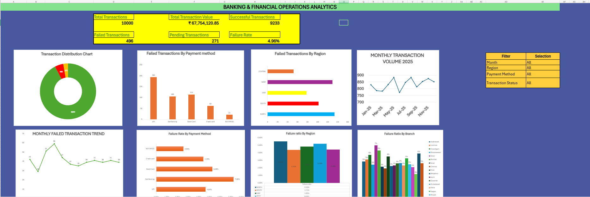

# Banking & Financial Operations Analytics

## Project Overview

This project analyzes 10,000 synthetic banking transactions using Python, Pandas, MySQL, Microsoft Excel, and Power BI to evaluate transaction performance, identify failure patterns, compare payment methods, and uncover regional and operational improvement opportunities.

## Business Objectives

- Analyze overall transaction performance.
- Calculate successful, failed, and pending transaction rates.
- Identify payment methods with higher transaction failure rates.
- Compare transaction failures across regions and branches.
- Analyze monthly transaction trends.
- Provide data-driven business recommendations.

## Dataset

- **Total records:** 10,000
- **Time period:** January–December 2025
- **Data type:** Synthetic banking transaction data

### Key Columns

`Transaction_ID`, `Customer_ID`, `Transaction_Date`, `Transaction_Amount`, `Transaction_Type`, `Payment_Method`, `Transaction_Status`, `Branch`, `Region`

## Tools & Technologies

- Python
- Pandas
- MySQL
- Microsoft Excel
- Power BI
- GitHub

## Key Findings

- **Overall success rate:** 92.33%
- **Overall failure rate:** 4.96%
- **Pending rate:** 2.71%
- **Highest payment-method failure rate:** Net Banking – 7.28%
- **Highest regional failure rate:** North – 5.53%
- **Highest branch-level failure rate:** Jaipur – 7.06%
- **Highest monthly failure rate:** April – 7.11%

## Excel Dashboard
### Dashboard Preview

The interactive Excel dashboard includes:

- 8 analytical charts covering transaction performance, payment methods, monthly trends, regional performance, and branch-level failures.
- 4 interactive filters:
  - Month
  - Region
  - Payment Method
  - Transaction Status
- Dynamic analysis based on selected filter combinations.

1. Investigate Net Banking transaction failures to identify possible payment-processing issues.
2. Review operational processes in branches with higher failure rates.
3. Monitor monthly transaction failure trends to identify recurring patterns.
4. Strengthen transaction monitoring and payment-system reliability.

## Project Status

- Python-based transaction analysis completed.
- Excel dashboard completed with 8 charts and 4 interactive filters.
- SQL and Power BI components should be documented here as they are finalized.

## Disclaimer
This project uses synthetic data created exclusively for educational and portfolio purposes. It does not contain real customer or banking information.

